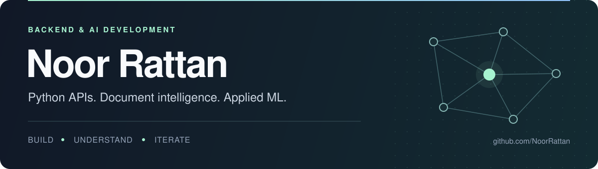

## Hi, I'm Noor.

I'm a Computer Science student focused on **AI and machine learning**. I build Python APIs, document intelligence tools, and web applications, with an interest in making model outputs traceable to their sources.

My projects range from citation-backed document chat to browser-based knowledge maps and developer tools with deterministic scoring.

**[Explore my repositories](https://github.com/NoorRattan?tab=repositories)** · **[What I work with](#what-i-work-with)**

## Selected projects

<table>
  <tr>
    <td width="50%" valign="top">
      <h3><a href="https://github.com/NoorRattan/Clauseora">Clauseora</a></h3>
      
Legal document navigation with explanations, comparisons, and answers linked to the exact supporting passage.

      
<code>Next.js</code> <code>TypeScript</code> <code>LLMs</code>

    </td>
    <td width="50%" valign="top">
      <h3><a href="https://github.com/NoorRattan/GitRoast.ai">GitRoast.ai</a></h3>
      
GitHub profile audits with deterministic scores, visible repository evidence, and shareable profile cards.

      
<code>FastAPI</code> <code>Next.js</code> <code>Cloudflare</code>

    </td>
  </tr>
  <tr>
    <td width="50%" valign="top">
      <h3><a href="https://github.com/NoorRattan/TextMosaic">TextMosaic</a></h3>
      
Interactive knowledge maps from text. On-device entity recognition and source quotes, with processing in the browser.

      
<code>TypeScript</code> <code>ONNX</code> <code>WebAssembly</code>

    </td>
    <td width="50%" valign="top">
      <h3><a href="https://github.com/NoorRattan/AskMyPDF">AskMyPDF</a></h3>
      
Upload a PDF, ask questions, and receive streamed answers grounded in retrieved document excerpts, with citations.

      
<code>FastAPI</code> <code>React</code> <code>RAG</code>

    </td>
  </tr>
  <tr>
    <td width="50%" valign="top">
      <h3><a href="https://github.com/NoorRattan/Scrap2Sync">Scrap2Sync</a></h3>
      
Turn rough developer notes into an editable standup draft. A rules-based default works without an API key.

      
<code>FastAPI</code> <code>Next.js</code> <code>TypeScript</code>

    </td>
    <td width="50%" valign="top">
      <h3><a href="https://github.com/NoorRattan/stadiumpulse">StadiumPulse</a></h3>
      
Connected stadium wayfinding and operations: crowd signals, accessible routes, and explanations of deterministic decisions.

      
<code>FastAPI</code> <code>React</code> <code>TypeScript</code>

    </td>
  </tr>
</table>

### More to explore

- **[CrowdIQ](https://github.com/NoorRattan/CROWDIQ)** — stadium crowd monitoring, queues, navigation, and venue operations.
- **[TruthLens](https://github.com/NoorRattan/truthlens)** — claim analysis using source credibility and web corroboration.
- **[AI Voice Detection](https://github.com/NoorRattan/AI-Voice-Detection)** — multilingual voice analysis with acoustic features and confidence scores.
- **[Carbon Footprint](https://github.com/NoorRattan/Carbon-Footprint-Awareness-Platform)** — activity tracking, emissions estimates, and reduction goals.
- **[Electra](https://github.com/NoorRattan/election)** — civic education and voter information across India, the UK, and the US.

## What I work with

**Languages** · Python, TypeScript, JavaScript, SQL 
**Backend & data** · FastAPI, PostgreSQL, Firebase, Redis 
**Web** · React, Next.js, Vite, Tailwind CSS 
**AI & ML** · PyTorch, ONNX, retrieval pipelines, model APIs 
**Delivery** · Docker, GitHub Actions, Cloudflare, pytest, Vitest

## How I approach a project

- Start with a specific workflow and build something people can try.
- Keep source evidence visible when an answer depends on a document or external data.
- Make model behavior, fallbacks, and limitations clear.
- Write tests and setup documentation alongside the implementation.

---

Browse the projects above for source code, architecture notes, and setup instructions.
